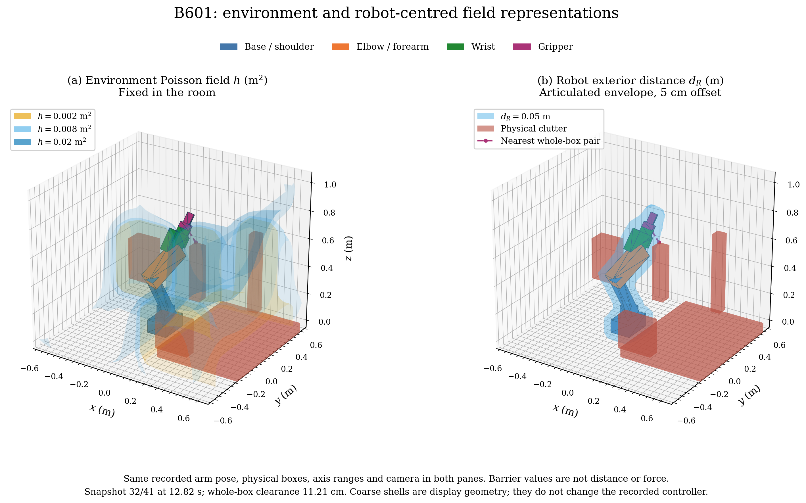

# B601 robot safety-filter demonstration

A portable static demonstration of collision filtering for a **fixed-base,
six-joint reBot B601-DM**, with recorded simulation poses and results. Open
[`index.html`](index.html) to explore the geometry, mathematical explanation,
and comparison of an environment-centred Poisson field with a robot-centred
distance-envelope method.

**[Open the interactive demo](https://peterwanghk.github.io/robot-safety-filter-demo/)**




## What the comparison means

- **Environment Poisson method:** one scalar field over buffered free space,
  queried at all 798 conservative robot-surface samples. Its values have units
  m² and are not distances or forces.
- **Robot-centred method:** moving distance envelopes around the robot, with
  a first-order velocity CBF for each of the **50 link-box/obstacle-box pairs**.
  Distances and margins have units m. The display envelope is separate from
  the actual pair constraints used by the Python controller.
- **Shared hierarchy:** sampled position reachability → collision-aware
  joint-space planning → velocity safety filter → simulated joint controller.

Geometric separation has a useful robot/environment duality, but these two
barrier functions generally produce different QP constraints and commands.
Read the [mathematical comparison](docs/MATH_COMPARISON.md) before interpreting
different colours or trajectories as different safety levels.

The page presents recorded poses and simulation diagnostics. Browsing time
steps, focusing a link region or adjusting static payload sliders does not
rerun the controller or modify the recorded physics. It provides neither
contact-force control nor hardware certification. Fixed fingers, conservative
link boxes, static known obstacles, finite-resolution paths and velocity
tracking assumptions limit the experiment. Self-collision, payload geometry,
the excluded visual floor, dynamic humans and mobile-base stability are outside
this demonstration.

The command panel contains **533 Poisson and 1,599 distance-filter projections**:
13 nominal joint motions at each of 41 recorded poses, with three distance
margins. These are independent local queries, not new closed-loop trajectories.
Use “Show an example correction” to inspect a command that a filter changes.
The inspectable cached geometry, projections and load coefficients are available
in [`comparison-data.zip`](comparison-data.zip); numerical and browser checks are
recorded in [`data/comparison_validation.json`](data/comparison_validation.json).

## Rebuild the comparison

To regenerate the fields and QP queries,
use Python 3.11 or newer and fetch the original licensed model:

```bash
python3 -m venv .venv
source .venv/bin/activate
python -m pip install -r requirements.txt
bash scripts/fetch_model.sh
python scripts/rebuild_demo.py
REBOT_ROOT="$PWD/vendor" python -m pytest -q
```

The generated comparison is `build/index.html`. The rebuild script does not
start ROS or advance the simulator. It uses the published recorded poses in
`data/recorded_poses.json`. Python package ranges support compatible wheel
selection; `data/tested_environment.json` records the original Jetson versions.
The full published page also retains the original recorded traces and joint-load
explorer. The rebuild script regenerates the field/command comparison section.

## Read the mathematics

- [Poisson versus robot-centred distance barriers](docs/MATH_COMPARISON.md)
- [Paper reproduction choices and mobile-manipulator limits](docs/PAPER_AND_MOBILE_LIMITATIONS.md)
- [Field and static-load explanation](docs/MATH_AND_LOAD_MODEL.md)
- [Source provenance and component licences](docs/SOURCE_PROVENANCE.md)

The reference paper is Wilkinson et al.,
[“Full-Body Dynamic Safety for Robot Manipulators: 3D Poisson Safety Functions for CBF-Based Safety Filters”](https://arxiv.org/abs/2604.21189).
This is an independent preliminary implementation, not released author code or
a reproduction of the paper's hardware performance.

## Acknowledgements and licensing

Robot descriptions and derived proxy geometry originate from
[Yang-Ci/ReBot_Arm_DigitalTwin_DM](https://github.com/Yang-Ci/ReBot_Arm_DigitalTwin_DM),
with the model source pinned in the provenance document. Robot-model-derived
assets retain **CERN-OHL-W-2.0** terms and notices. The demonstration also uses
[Plotly](https://github.com/plotly/plotly.js),
[KaTeX](https://github.com/KaTeX/KaTeX), and
[SciencePlots](https://github.com/garrettj403/SciencePlots). Their applicable
MIT notices are retained in [`LICENSES`](LICENSES/); these components do not
relicense the robot model. No endorsement by the paper's authors, Seeed Studio,
CERN or the library maintainers is implied.
